# Arquitectura

Lumia Studio es un monorepo de npm con una web en Vue, una API GraphQL en AWS AppSync, un agente en Amazon Bedrock AgentCore Runtime y una app de AWS CDK con siete stacks. Esta página resume las piezas, cómo se conectan y qué recursos crea cada stack.

## Componentes

| Componente | Código | Se ejecuta en | Función |
|---|---|---|---|
| Web | `apps/web` (`@lumia/web`) | S3 y CloudFront | Editor con árbol, lienzo, propiedades, línea de tiempo, comentarios, medios, vista previa y panel de Lumi. |
| API de Studio | `apps/api` (`@lumia/api`) | AppSync y Lambda | Esquema GraphQL, autorización con Cedar, servicios, repositorios y migraciones. |
| Studio MCP | `apps/api/src/mcp` | Lambda detrás de AgentCore Gateway | Herramientas de Lumi. Cada herramienta llama a la API con el token de la persona. |
| Lumi | `apps/agent` (`@lumia/agent`) | AgentCore Runtime, en un contenedor arm64 | Agente de cocreación. Sirve AG-UI y usa un modelo de Amazon Bedrock. |
| Código compartido | `packages` (`@lumia/packages`) | Se empaqueta con cada app | Catálogo de componentes (`catalog`) y contrato de entorno de Lumi (`lumi-env`). |
| Infraestructura | `bin`, `lib` | AWS CloudFormation | App de CDK con las verificaciones de cdk-nag. |
| Sandbox | `sandbox` (`@lumia/sandbox`) | Máquina local | Reemplaza Aurora, AppSync, Cognito, S3 y los gateways. |

## Cómo se conectan

- **Edición.** La web llama a AppSync con el access token de Cognito. Un resolver invoca la Lambda del campo, que evalúa los permisos con Cedar y usa Aurora por la Data API. Ver [api.md](api.md).
- **Archivos.** Los medios, las narraciones y las clases publicadas viven en S3 y se leen con URLs firmadas. Publicar una clase exporta su `.lumia` al bucket `Published`. Ver [data.md](data.md).
- **Identidad.** Cognito identifica a la persona. Studio lee su rol y su acceso de la base de datos. Ver [authentication.md](authentication.md).
- **Lumi.** La web llama al gateway de entrada `lumia-lumi-entry`. El runtime ejecuta Lumi, que usa las herramientas por el gateway MCP `lumia-studio-tools` con el token de la persona. Ver [lumi.md](lumi.md).

La base de datos no recibe conexiones de red: vive en subredes aisladas y las funciones usan la Data API. Lumi no accede a la base de datos.

## Los 7 stacks

`lib/studio-app.ts` crea los stacks en este orden.

| Orden | Stack | Recursos | Recibe de otros stacks |
|---|---|---|---|
| 1 | `LumiaStudioDataStack` | Red sin NAT, Aurora PostgreSQL Serverless v2 con Data API, secretos de `lumia_admin` y `studio_app`, migraciones en cada despliegue que las cambie, buckets `Media` y `Published`, y políticas de acceso. | Nada |
| 2 | `LumiaStudioIdentityStack` | User pool de Cognito, cliente `Web` y Lambda `PreTokenGeneration`. | Nada |
| 3 | `LumiaStudioStack` | API AppSync `lumia-studio`, cinco Lambdas de resolvers (`documents`, `media`, `narration`, `publish`, `tree`) y Lambda `Export`. | Datos e identidad |
| 4 | `LumiaStudioMcpStack` | Cuatro Lambdas de herramientas, una por target del gateway. No tienen permisos de AWS sobre los datos. | URL de GraphQL |
| 5 | `LumiaStudioAgentStack` | Gateway MCP `lumia-studio-tools` y, si hay ARN del runtime, gateway de entrada `lumia-lumi-entry`. | User pool, cliente web y Lambdas MCP. El ARN del runtime llega por `LUMIA_LUMI_RUNTIME_ARN`. |
| 6 | `LumiaStudioAgentRuntimeStack` | Runtime `lumia_lumi`, imagen construida desde `apps/agent/Dockerfile`, bucket `Sessions` y permisos de Bedrock. | URL del gateway MCP, user pool y cliente web |
| 7 | `LumiaStudioWebStack` | Bucket `Site`, distribución de CloudFront y `config.json`. | URL de GraphQL, ids de Cognito y URL de Lumi |

`LumiaStudioAgentRuntimeStack` necesita la URL del gateway MCP, así que va después de `LumiaStudioAgentStack`. El gateway de entrada de ese stack necesita el ARN del runtime. Para evitar el ciclo, el ARN se pasa con `LUMIA_LUMI_RUNTIME_ARN` en una segunda pasada. `LumiaStudioWebStack` va al final porque necesita la URL de cada servicio. El procedimiento está en [operations/deployment.md](../operations/deployment.md).

## Web

| Ruta | Página | Acceso |
|---|---|---|
| `/sign-in` | `SignInPage.vue` | Público |
| `/` | `WorkspacePage.vue` | Requiere sesión y la acción `documents.view` |

La interfaz deshabilita lo que el rol de la persona no permite. La API aplica los mismos permisos con Cedar.

La web lee `/config.json` al iniciar. En AWS, `LumiaStudioWebStack` genera ese archivo. En local, `sandbox/scripts/dev.sh` escribe `apps/web/public/config.json`, que no se versiona.

| Campo | Propósito |
|---|---|
| `apiUrl` | Endpoint GraphQL |
| `authMode` | `dev` o `cognito` |
| `lumiUrl` | Endpoint AG-UI de Lumi, o `null`. Con `null`, el panel de Lumi lo indica y el editor funciona por su cuenta. |
| `cognito.userPoolId` | User pool. Requerido con `cognito`. |
| `cognito.userPoolClientId` | Cliente web. Requerido con `cognito`. |

## Perfil común de la infraestructura

| Pieza | Configuración | Propósito |
|---|---|---|
| `PrivateBucket` | Cifrado administrado por S3, TLS 1.2 o superior, acceso público bloqueado y logs de acceso. | Ningún bucket es público. |
| `StudioFunction` | Node.js 24 en ARM, bundle ESM, X-Ray y grupo de logs con retención de un mes. | Todas las Lambdas siguen el mismo perfil. |
| Aurora | Escala hasta 0 ACU por defecto y se pausa sin conexiones. | Reduce el costo cuando nadie usa el sistema. Reanudar toma unos 15 segundos. |
| cdk-nag | `AwsSolutionsChecks` corre en cada síntesis. | Un hallazgo sin reconocimiento detiene la síntesis. |

Siguiente: [API de Studio](api.md)
