# Lumi

Lumi es el agente de cocreación de Lumia Studio. Crea y edita clases desde el panel del editor y guía a la persona por la pantalla. Esta página describe el recorrido de un mensaje, las partes del agente, la conversación y el consentimiento.

Lumi usa el SDK de Strands para TypeScript y su harness (`createHarness`), y sirve AG-UI sobre SSE. Funciona igual en local y en Amazon Bedrock AgentCore Runtime.

- **Reactivo.** Actúa solo sobre lo que la persona pide. No sugiere ni revisa por iniciativa propia.
- **Con los permisos de la persona.** Usa su token en cada llamada a Studio.
- **Con consentimiento.** Ningún cambio se ejecuta sin la aceptación de la persona.
- **Dueño de la conversación.** El servidor guarda la conversación e ignora el historial que reenvía el cliente.

## Recorrido de un mensaje

1. La persona escribe en el panel de Lumi.
2. La web obtiene el access token vigente.
3. La web llama al gateway de entrada con el token.
4. El gateway valida el token y lo reenvía sin cambios.
5. El runtime restaura la conversación desde S3.
6. El modelo de Bedrock decide qué necesita leer.
7. Lumi llama al gateway MCP con el token de la persona.
8. El gateway invoca la herramienta y propaga la cabecera del token.
9. La herramienta llama a AppSync con ese token.
10. AppSync ejecuta el resolver del campo.
11. El resolver evalúa Cedar y consulta Aurora.
12. Lumi transmite la respuesta a la web por SSE.

En el código, el mismo recorrido pasa por estas clases:

1. `LumiSession` (`apps/web/src/features/lumi/lumi-session.ts`) guarda los cambios pendientes del editor y lo deja en solo lectura durante el turno.
2. La web envía con `HttpAgent` de AG-UI el mensaje, las herramientas de pantalla y el contexto de pantalla al `lumiUrl` de `config.json`.
3. `AguiServer` recibe `POST /invocations`, resuelve a la persona y valida `RunAgentInput`.
4. `ThreadRegistry` presta el agente de esa persona y esa conversación, o lo crea.
5. `InputGuard` conserva solo el mensaje nuevo y las respuestas a llamadas pendientes.
6. `@ag-ui/aws-strands` ejecuta el turno con el agente de Strands. Los eventos llegan al navegador por SSE.
7. Si Lumi llama a una herramienta de pantalla, la ejecución se detiene. La web ejecuta la herramienta y envía el resultado en una petición nueva.
8. Al terminar el turno, la web recarga la clase si Lumi la cambió y desbloquea el editor.

## Agente

`LumiAgentFactory` crea un agente por persona y conversación con `createHarness`.

| Parte | Clase o archivo | Función |
|---|---|---|
| Instrucciones | `src/prompts/lumi.md` | Se agregan después del contrato del harness. |
| Modelo | `BedrockModelFactory` | Crea el modelo de Bedrock con caché de prompts `auto` y guardrail opcional. |
| Herramientas de Studio | `StudioMcpConnector` | Conecta con el Studio MCP y filtra con `get_my_access`. |
| Skills | `skills/<name>/SKILL.md` | Instrucciones que se cargan bajo demanda. |
| Consentimiento | `ConfirmationGate` | Retiene los cambios sin aceptación. |
| Llamadas pendientes | `FrontendCallLedger` | Registra las llamadas a herramientas de pantalla que Lumi hizo. |
| Cierre de turnos | `UnfinishedTurnCloser` | Cierra un turno que terminó sin respuesta, al llegar el mensaje siguiente. |
| Conversaciones | `ConversationStore` | Guarda la conversación después de cada mensaje. |
| Preferencias | `FilePreferenceMemory` | Guarda preferencias por persona. |

Lumi no tiene herramientas de shell, archivos, web ni subagentes, y no ejecuta tareas en segundo plano. Sus herramientas y skills están en [lumi-tools.md](lumi-tools.md).

Por defecto usa `us.anthropic.claude-sonnet-4-6`, Claude Sonnet 4.6 por el perfil de inferencia de EE. UU. Los prompts, las skills y la política se leen una vez al iniciar; un archivo inválido detiene el arranque.

## Conversación

El servidor es el dueño de la conversación. De cada petición, `InputGuard` conserva solo:

- el mensaje nuevo de la persona, solo texto;
- las respuestas a las llamadas de pantalla que Lumi está esperando;
- las herramientas declaradas, dentro de los límites;
- el contexto de pantalla, sanitizado.

Una llamada de pantalla sin respuesta recibe un resultado explícito de "no respondida".

| Dato | En AWS | En local | Ruta |
|---|---|---|---|
| Conversación | Bucket `Sessions` | `.sandbox/lumi/sessions` | `<actorKey>/<sessionId>/scopes/agent/lumi/snapshots/` |
| Resultados grandes de herramientas | Bucket `Sessions` | `.sandbox/lumi/sessions` | `<actorKey>/context/<sessionId>/` |
| Preferencias | `/tmp/lumi-memory` en el contenedor | `.sandbox/lumi/memory` | `<actorKey>/` |
| Lista de conversaciones y transcripción visible | `localStorage` del navegador | `localStorage` del navegador | `lumia.studio.lumi.<userId>` |

En S3, las rutas van bajo el prefijo `LUMI_SESSION_PREFIX`. `actorKey` es un hash del `sub` del token y `sessionId` es un hash del id de la conversación. Si otra persona envía el mismo id, obtiene una conversación nueva y vacía.

El runtime guarda las preferencias con `LUMI_MEMORY_DIR`, en el almacenamiento de escritura del contenedor, y no usa AgentCore Memory. El código incluye `AgentCorePreferenceMemory`, que se activa con `LUMI_MEMORY_ID`, pero `LumiaStudioAgentRuntimeStack` no define esa variable.

`ThreadRegistry` mantiene un agente por persona y conversación. Un agente se libera tras `LUMI_THREAD_IDLE_MINUTES` sin uso, y la conversación sigue en almacenamiento. Si el token cambia, el agente se crea de nuevo porque la conexión MCP lleva el token, y la sesión restaura la conversación.

## Consentimiento

Un cambio solo se ejecuta si la persona lo aceptó en el mismo turno y con los mismos argumentos. Un turno va desde un mensaje de la persona hasta que Lumi termina de trabajar en él.

1. La persona pide un cambio.
2. El mensaje llega al runtime con el token.
3. Lumi prepara el cambio con el modelo.
4. El cambio pasa por `ConfirmationGate`.
5. Lumi llama a `confirm_change` y la web muestra la tarjeta.
6. La persona confirma y la web responde `{ confirmed: true }`.
7. Con la misma herramienta y argumentos, el gate aprueba la llamada.
8. El gateway invoca la herramienta.
9. La herramienta llama a AppSync con el token de la persona.
10. AppSync ejecuta el resolver.
11. Studio evalúa los permisos y guarda el cambio.
12. Lumi informa el resultado por SSE.

La forma de `confirm_change` está en [lumi-tools.md](lumi-tools.md).

`ConfirmationGate` revisa cada llamada a una herramienta y decide si se ejecuta. Solo lee la conversación del servidor, así que el cliente no puede falsificar una aprobación.

| Situación | Resultado | Log |
|---|---|---|
| Herramienta que no necesita consentimiento | Se ejecuta | Ninguno |
| Cambio aceptado en el turno, con los mismos argumentos y sin usar | Se ejecuta y consume la aprobación | `Change approved by the person` |
| Cambio sin confirmación válida | Se retiene | `Change held back` con `no matching consent` |
| La persona rechazó un cambio en este turno | Se retiene | `Change held back` con `declined in this turn` |
| `confirm_change` sin el formato esperado | Se ignora y no otorga nada | `Confirmation ignored: invalid request` |
| Fallo interno del gate | Se deniega | Ninguno propio |

- Cada aprobación se usa una vez.
- Una escritura en la misma respuesta del modelo que su confirmación se retiene, porque la respuesta de la persona no existe en ese momento.
- Después de un rechazo, nada más cambia en ese turno.
- Una respuesta con `error` no cuenta como rechazo: Lumi puede corregir la petición y preguntar otra vez.
- Si una escritura creó un borrador, el gate traduce los ids aprobados con `idMap`.

`apps/agent/policies/confirmation.json` define la política: `confirmationTool` es `confirm_change`, `readOnlyTargets` lista los targets que solo leen (`studio-read` y `knowledge`) y `maxChangesPerConfirmation` es 20. Toda herramienta de otro target necesita consentimiento, así que un target nuevo queda protegido hasta que se agregue a esa lista. `OPEN_TARGETS` y `readOnlyTargets` incluyen `knowledge`, pero `LumiaStudioAgentStack` no crea ese target.

Siguiente: [Herramientas y skills de Lumi](lumi-tools.md)
