# Despliegue

Lumia Studio se despliega con AWS CDK en siete stacks. `scripts/deploy-all.sh` despliega un entorno completo en tres pasadas. Un entorno existente se actualiza como indica [Actualizar un entorno existente](#actualizar-un-entorno-existente), porque algunos comandos eliminan el gateway de entrada de Lumi.

## Tres pasadas del despliegue



1. Data, Identity, Studio, Mcp, Agent y AgentRuntime.
2. `LumiaStudioAgentStack` otra vez, con `LUMIA_LUMI_RUNTIME_ARN`, para crear el gateway de entrada.
3. `LumiaStudioWebStack`, con `LUMIA_LUMI_URL`.

Las pasadas existen por dos dependencias de Lumi: el gateway de entrada necesita el ARN del runtime, y la web necesita la URL del gateway de entrada. La pasada 1 crea el gateway MCP y el runtime, sin gateway de entrada. Entre pasadas, `scripts/deploy-all.sh` lee `RuntimeArn` y `LumiUrl` de las salidas de los stacks, y despliega las pasadas 2 y 3 con `--exclusively`.

`npm run deploy` ejecuta `cdk deploy --all` y no encadena las pasadas. El contenido de cada stack está en [architecture/README.md](../architecture/README.md).

## Requisitos

| Requisito | Motivo |
|---|---|
| Node.js 22.13 o posterior y npm | CDK y empaquetado |
| Docker | Construye la imagen arm64 del agente durante el despliegue |
| AWS CLI y credenciales | `scripts/deploy-all.sh` lee las salidas de los stacks con `aws cloudformation` |
| `npx cdk bootstrap` | Se ejecuta una vez en cada cuenta y región |

## Primer despliegue

```bash
npm install
npx cdk bootstrap
LUMIA_AWS_REGION=<region> scripts/deploy-all.sh
```

La región sale de `LUMIA_AWS_REGION`, luego de `AWS_REGION`. Si ninguna está definida, el script usa `us-east-1`. Al terminar imprime las URL de la web y de Lumi. Las salidas quedan en `.sandbox/deploy-all-outputs.json`.

Las migraciones se ejecutan durante el despliegue de `LumiaStudioDataStack`, pero no cargan roles, personas ni árbol de contenido. Después del primer despliegue se cargan a mano: ver [content.md](content.md).

## Actualizar un entorno existente

Para actualizar un stack de Lumi, se definen `LUMIA_LUMI_RUNTIME_ARN` y `LUMIA_LUMI_URL`, y se despliega solo ese stack con `--exclusively`.

```bash
export LUMIA_LUMI_RUNTIME_ARN="$(aws cloudformation describe-stacks --region <region> \
  --stack-name LumiaStudioAgentRuntimeStack \
  --query "Stacks[0].Outputs[?OutputKey=='RuntimeArn'].OutputValue | [0]" --output text)"
export LUMIA_LUMI_URL="$(aws cloudformation describe-stacks --region <region> \
  --stack-name LumiaStudioAgentStack \
  --query "Stacks[0].Outputs[?OutputKey=='LumiUrl'].OutputValue | [0]" --output text)"
npx cdk deploy <stack> --exclusively
```

| Variable | Protege |
|---|---|
| `LUMIA_LUMI_RUNTIME_ARN` | El gateway de entrada en `LumiaStudioAgentStack` |
| `LUMIA_LUMI_URL` | El `lumiUrl` de `config.json` en `LumiaStudioWebStack` |

`--exclusively` evita que CDK despliegue también los stacks de los que depende el indicado. `LumiaStudioDataStack`, `LumiaStudioIdentityStack`, `LumiaStudioStack` y `LumiaStudioMcpStack` no dependen de esas variables.

Los esquemas de las herramientas viven en los targets de `LumiaStudioAgentStack`. Agregar o cambiar una herramienta exige desplegar `LumiaStudioMcpStack` y también ese stack.

## Riesgos conocidos

| Riesgo | Causa | Prevención |
|---|---|---|
| Se elimina el gateway de entrada | Sin `LUMIA_LUMI_RUNTIME_ARN`, `LumiaStudioAgentStack` se sintetiza sin ese gateway. Desplegarlo lo elimina. | Definir la variable al desplegar ese stack. |
| Cambia la URL de Lumi | La pasada 1 de `deploy-all.sh` despliega `LumiaStudioAgentStack` sin la variable si no está definida. El gateway se recrearía con otra URL. | En un entorno existente, definir `LUMIA_LUMI_RUNTIME_ARN` al ejecutar el script. |
| La web queda sin Lumi | Sin `LUMIA_LUMI_URL`, la web usa `lumi.entryUrl`. Si tampoco hay ARN, Lumi queda sin configurar. | Definir `LUMIA_LUMI_URL` al desplegar `LumiaStudioWebStack`. |
| `npm run deploy` deja el entorno incompleto | No encadena las pasadas. Sin variables, elimina el gateway de entrada y deja la web sin Lumi. | Usar `scripts/deploy-all.sh`, o definir ambas variables. |
| Cambios de IAM sin revisión | `deploy-all.sh` usa `--require-approval never`. | Revisar primero con `npx cdk diff`, con las mismas variables. |

Sin Lumi configurado, el panel lo indica y el editor sigue funcionando.

## Imagen del agente

La imagen es arm64 y requiere Docker durante el despliegue. CDK la construye desde la raíz del repositorio con `apps/agent/Dockerfile`.

- La etapa de compilación empaqueta el agente con esbuild.
- La etapa final contiene el bundle, los prompts, las skills y la política. No contiene `node_modules`.
- El contenedor corre con el usuario `node`, escucha en el puerto 8080 y tiene un `HEALTHCHECK` en `/ping`.

`apps/agent/scripts/build.ts` usa `mainFields: ['module', 'main']`. Un chunk generado desde un paquete CommonJS solo exporta `default`, y el SDK de Strands lee exports con nombre de `import('@aws-sdk/client-s3')`.

## Verificación con cdk-nag

La síntesis ejecuta las verificaciones de AWS Solutions. Un hallazgo sin reconocimiento la detiene.

```bash
npm run synth
```

`npm run verify` agrega type check, lint y pruebas unitarias.

## Stacks y salidas

| Orden | Stack | Salidas |
|---|---|---|
| 1 | `LumiaStudioDataStack` | `DatabaseClusterArn`, `DatabaseAdminSecretArn`, `MediaBucketName`, `PublishedBucketName` |
| 2 | `LumiaStudioIdentityStack` | `UserPoolId`, `WebClientId` |
| 3 | `LumiaStudioStack` | `GraphqlUrl` |
| 4 | `LumiaStudioMcpStack` | Ninguna |
| 5 | `LumiaStudioAgentStack` | `McpGatewayUrl`, `McpGatewayArn` y, con el ARN del runtime, `LumiUrl` |
| 6 | `LumiaStudioAgentRuntimeStack` | `RuntimeArn` |
| 7 | `LumiaStudioWebStack` | `WebUrl` |

## Configuración

`bin/lumia-studio.ts` lee `.env` y `lib/deploy-config.ts` valida los valores. Una variable definida en el shell gana sobre `.env`.

| Variable | Propósito |
|---|---|
| `LUMIA_AWS_ACCOUNT` | Cuenta de los stacks, de 12 dígitos. Sin ella se usa `CDK_DEFAULT_ACCOUNT`. |
| `LUMIA_AWS_REGION` | Región de los stacks. Sin ella se usa `CDK_DEFAULT_REGION`. |
| `LUMIA_DB_MIN_ACU` | Capacidad mínima de Aurora. Por defecto 0, que permite la pausa. |
| `LUMIA_DB_MAX_ACU` | Capacidad máxima de Aurora. Por defecto 1. |
| `LUMIA_DB_AUTO_PAUSE_MINUTES` | Minutos sin conexiones hasta la pausa, de 5 a 1440. Por defecto 5. Aplica solo con mínimo 0. |
| `LUMIA_LUMI_RUNTIME_ARN` | ARN de AgentCore Runtime. Sin él, `LumiaStudioAgentStack` no crea el gateway de entrada. |
| `LUMIA_LUMI_URL` | Endpoint de Lumi para la web. Sin él, la web usa `lumi.entryUrl`. |

La capacidad va de 0.5 en 0.5 ACU, hasta 256.

`LUMIA_LUMI_URL` también acepta una ruta como `/lumi/invocations`, pero `LumiaStudioWebStack` no crea ese comportamiento en CloudFront. En AWS se usa la URL `https` del gateway de entrada.

Siguiente: [Contenido y accesos](content.md)
